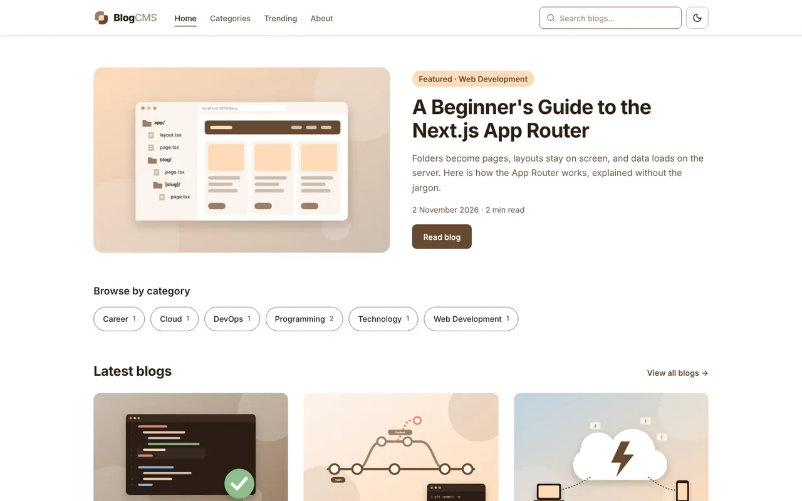
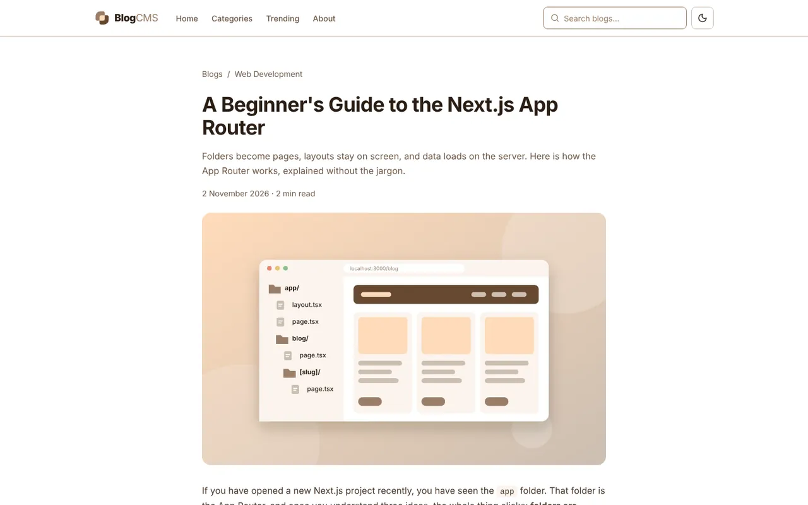
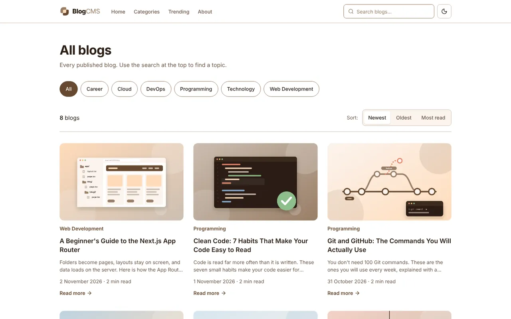
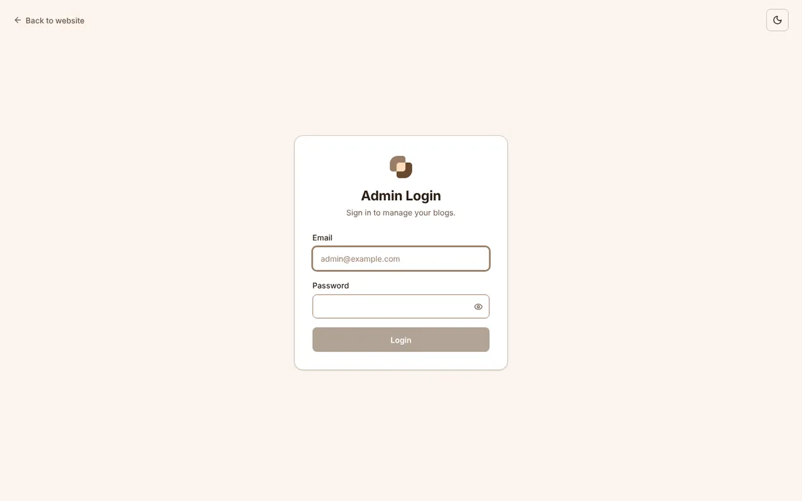
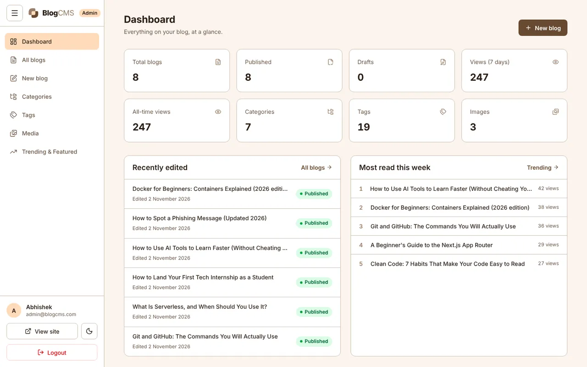
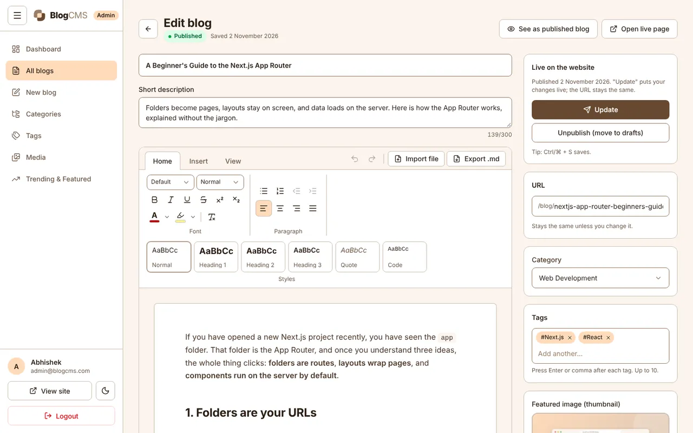
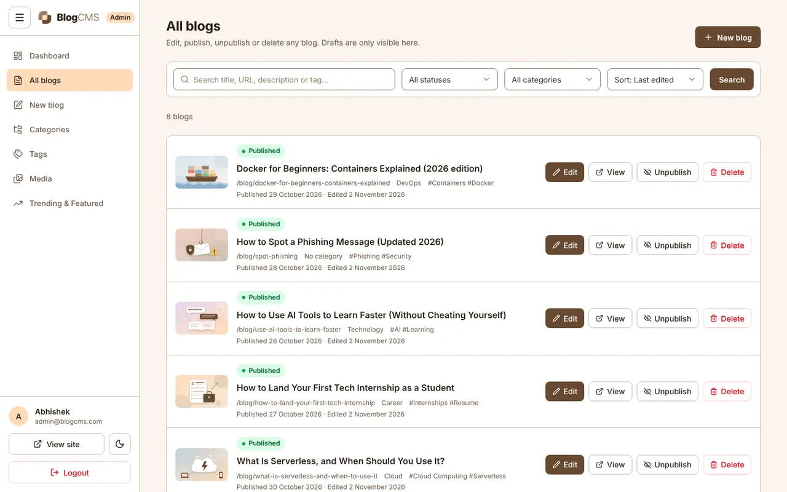
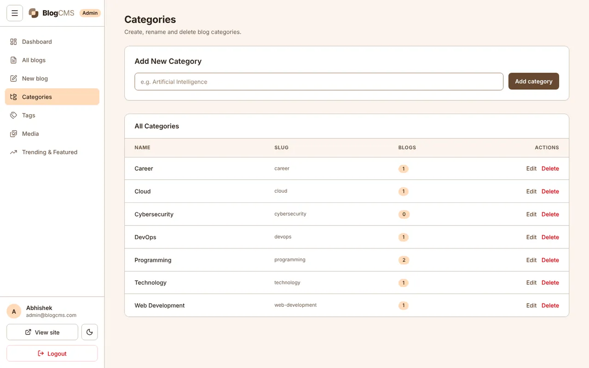
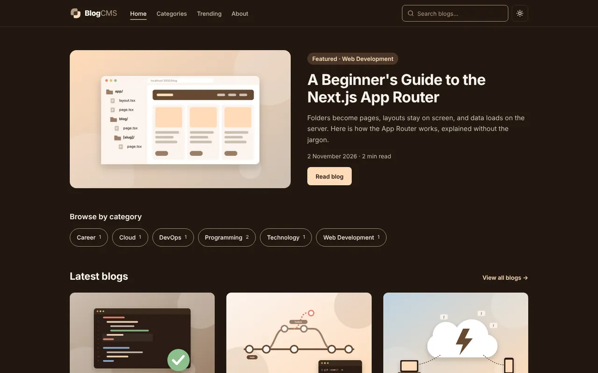
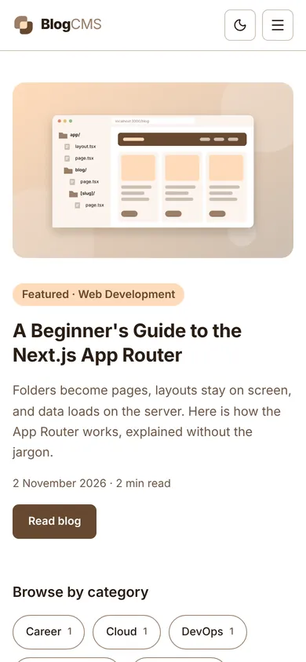

# BlogCMS

A full-stack blog platform with two parts:

- **Admin CMS** (`/admin`): the admin logs in, writes blogs in a Word-style editor (or uploads a Markdown file), adds images, a category and tags, then saves a draft or publishes.
- **Public blog website** (`/`): anyone can read published blogs, search, filter by category and open a blog. Readers can also create a free account to like, save and comment on blogs.

Everything comes from the database through the API. When the admin edits or publishes a blog, the website shows the change right away.

| | |
|---|---|
| **Live website** | _add your Vercel URL here_ |
| **Live API** | same URL, under `/api` (e.g. `/api/blogs/public`) |
| **Admin login** | `/admin/login` with the email and password from [Admin account](#5-create-the-admin-account) |



---

## Features

### Admin CMS

- **Login** with email and password. Passwords are hashed with **bcrypt**; the session is a signed **JWT** in an httpOnly cookie (7 days). Every admin page and admin API is protected; logged-out visitors are sent to `/admin/login` and API calls get `401`.
- **Dashboard**: total, published and draft blogs, categories, tags, images, views, readers, comments, likes, saves, recently edited and most read blogs (all from the database).
- **Blog management**: list with search, status and category filters, sorting and pagination. Create, edit, publish, unpublish, delete (with a confirmation dialog).
- **Rich text editor** (Tiptap), laid out like Microsoft Word:
  - Bold, italic, underline, strikethrough, superscript, subscript
  - Headings 1 to 3, paragraph, quote, code block, bullet and numbered lists, indent
  - **Font** (Default, Arial, Roboto, Poppins, Georgia, Times New Roman, Courier New) and **font size** (Small, Normal, Large, Extra Large)
  - Text colour, highlight colour, text alignment, undo and redo
  - Links, images inside the article with **captions**, tables, dividers
  - **Emoji** picker and **stickers**
  - Full-screen mode, word count and reading time
- **Markdown upload**: "Import file" accepts `.md` (also `.txt`, `.html`, `.docx` and `.pdf`). The file is checked, converted to editor content and stays fully editable.
- **Markdown export**: "Export .md" downloads the blog as a Markdown file.
- **Images**: thumbnail and in-article images are uploaded to **Cloudinary** (JPG, PNG, JPEG, WEBP, up to 10 MB). Every upload goes into the **Media library**, where images can be reused.
- **Categories and tags**: create, rename and delete. Tags can also be typed straight into the blog form.
- **Draft / Published**: drafts are only visible in the admin panel. Publishing needs a description, content and a thumbnail.
- **Auto slug**: `Learn React From Scratch` becomes `/blog/learn-react-from-scratch`. Duplicate slugs get `-2`, `-3`...
- **Preview** ("See as published blog") before publishing.
- **Auto save**: unsaved work is kept in the browser and offered back after a refresh or crash. `Ctrl/⌘ + S` saves.
- **SEO fields**: optional title and description for search engines.
- **Trending & Featured**: choose the homepage featured blog and the editor's picks.
- **Comments**: see every reader comment (newest first) and delete spam or rude ones.
- **Readers**: list of reader accounts with their likes, saves and comments.
- Toast messages for every action, loading states, empty states, and an "unsaved changes" warning.

### Public website

- **Homepage**: navbar, featured blog, categories, latest blogs, footer.
- **Blog cards**: thumbnail, category, title, short description, date, reading time, "Read more".
- **Blog listing** (`/blogs`): 3 columns on desktop, 1 on mobile, with pagination and sorting (newest, oldest, most read).
- **Blog details** (`/blog/:slug`): title, thumbnail, category, tags, date, reading time, content, **share buttons** (copy link, WhatsApp, LinkedIn) and **related blogs** from the same category.
- **Search** in the navbar: matches title, description, tags and category.
- **Category filter** and **tag filter** (click a tag on a blog).
- **Categories**, **Trending** and **About** pages, plus a friendly 404 page.
- **Dark mode** toggle on every page, remembered per browser.
- **Responsive**: tested at 1440px, 1024px, 768px and 390px, with a hamburger menu on mobile.

### Reader accounts

Reading stays open to everyone. A free account adds:

- **Sign up / log in / log out** (`/signup`, `/login`) with name, email and password. Passwords are hashed with bcrypt; the session is a signed JWT in an httpOnly cookie (30 days). After logging in, the reader goes back to the page they were on.
- **Like** a blog (heart with a live count).
- **Save** a blog and find it later on **Saved blogs** (`/saved`).
- **Comment** on a blog, and delete their own comments. Comments are plain text (up to 1000 characters).
- **My account** (`/account`): name, email, join date, and how many blogs they liked, saved and commented on.
- Visitors who click Like, Save or Comment are asked to log in first.
- Reader and admin logins are completely separate: a reader's login can't open the admin panel, and the admin's login doesn't count as a reader.

## Screenshots

| Blog details | Blog listing |
|---|---|
|  |  |
| **Admin login** | **Dashboard** |
|  |  |
| **Blog editor** | **Blog management** |
|  |  |
| **Categories** | **Dark mode** |
|  |  |



## Tech stack

| Part | Technology |
|---|---|
| Frontend | Next.js 16 (App Router), React 19, TypeScript, Tailwind CSS v4 |
| Backend | Next.js Route Handlers (REST API in `src/app/api`), Node.js 22 |
| Database | PostgreSQL on Neon, Prisma ORM 7 |
| Auth | JWT (`jose`) in an httpOnly cookie, `bcryptjs` password hashing |
| Validation | Zod (same rules on the frontend and the backend) |
| Editor | Tiptap 3, `marked` (Markdown in), `turndown` (Markdown out), `sanitize-html` |
| Images | Cloudinary (signed uploads) |
| UI | lucide-react icons, sonner toasts |

The frontend and backend live in one Next.js app, so one deployment gives both the website and the API.

## How to run the project

### 1. Install

```bash
git clone https://github.com/Sam-X-Dev/Blog-CMS.git
cd Blog-CMS
npm install
```

Node.js 22 or newer is needed. `npm install` also generates the Prisma client.

### 2. Environment variables

```bash
cp .env.example .env
```

| Variable | What it is |
|---|---|
| `DATABASE_URL` | Neon Postgres **pooled** connection string (host contains `-pooler`) |
| `DIRECT_URL` | Neon Postgres **direct** connection string (used for migrations) |
| `JWT_SECRET` | Random string, at least 32 characters. Make one with `openssl rand -base64 32` |
| `CLOUDINARY_CLOUD_NAME` | From the Cloudinary dashboard |
| `CLOUDINARY_API_KEY` | From the Cloudinary dashboard |
| `CLOUDINARY_API_SECRET` | From the Cloudinary dashboard |

### 3. Database setup

Create a free database on [neon.tech](https://neon.tech), put its connection strings in `.env`, then create the tables:

```bash
npm run db:deploy      # applies the migrations in prisma/migrations
npm run db:seed        # adds the starting categories
```

> **Database that was set up earlier with `prisma db push`:** those tables already exist, so mark the first two migrations as done, then run the rest:
>
> ```bash
> npx prisma migrate resolve --applied 20261010095011_init
> npx prisma migrate resolve --applied 20261104000000_trending_featured_seo_views
> npm run db:deploy
> ```
>
> (Skip a `resolve` line if it says it is already applied.) Do **not** run `prisma migrate dev` on a database with real data; it can offer to reset it.

Optional: `npm run db:replace-blogs` fills the site with 8 ready-made blogs and covers.

### 4. Start

```bash
npm run dev
```

Website: <http://localhost:3000> · Admin: <http://localhost:3000/admin>

### 5. Create the admin account

```bash
npm run db:create-admin -- --email admin@example.com --password "a-strong-password" --name "Admin"
```

Running it again with the same email resets that admin's password. Then log in at `/admin/login`.

## Deployment (Vercel)

1. Push the code to GitHub and import the repository on [vercel.com](https://vercel.com).
2. Add the six environment variables from the table above in **Project → Settings → Environment Variables**.
3. Deploy. Vercel runs `npm install` (which generates the Prisma client) and `npm run build`.
4. Create the admin account once (step 5 above, run on your computer with the production `.env`).
5. Put the live URL and admin login at the top of this README.

## Pages

| Public | Admin |
|---|---|
| `/` homepage | `/admin/login` |
| `/blogs` all blogs (search, filter, sort, pages) | `/admin` dashboard (also `/admin/dashboard`) |
| `/blog/:slug` blog details | `/admin/blogs` blog management |
| `/categories`, `/categories/:slug` | `/admin/blogs/new` create blog (also `/admin/blogs/create`) |
| `/trending` | `/admin/blogs/:id/edit` edit blog (also `/admin/blogs/edit/:id`) |
| `/about` | `/admin/categories`, `/admin/tags`, `/admin/media`, `/admin/trending` |
| `/login`, `/signup` reader log in / sign up | `/admin/comments` comment moderation |
| `/saved` saved blogs, `/account` my account | `/admin/readers` reader accounts |

## API

Every response uses the same shape:

```json
{ "success": true, "message": "Blog created", "data": { "id": "...", "title": "Learn React" } }
```

```json
{ "success": false, "message": "Blog not found" }
```

Validation errors add `"errors": { "title": ["Title must be at least 5 characters"] }`.

🔒 = needs the admin login cookie (otherwise `401`). 👤 = needs a reader login (otherwise `401`).

| Method | Endpoint | |
|---|---|---|
| POST | `/api/auth/login` | Log in (`{ email, password }`), sets the cookie |
| POST | `/api/auth/logout` | Log out |
| GET | `/api/blogs` | 🔒 All blogs (drafts too), with `q`, `status`, `category`, `sort`, `page` |
| POST | `/api/blogs` | 🔒 Create a blog |
| GET | `/api/blogs/:id` | 🔒 One blog |
| PUT | `/api/blogs/:id` | 🔒 Update a blog |
| DELETE | `/api/blogs/:id` | 🔒 Delete a blog |
| PATCH | `/api/blogs/:id/status` | 🔒 Publish or unpublish |
| GET | `/api/blogs/public` | Published blogs, with `q`, `category`, `tag`, `sort`, `page` |
| GET | `/api/blogs/public/featured` | The homepage featured blog |
| GET | `/api/categories` | All categories |
| POST | `/api/categories` | 🔒 Create a category |
| GET | `/api/categories/:id` | One category |
| PUT | `/api/categories/:id` | 🔒 Rename a category |
| DELETE | `/api/categories/:id` | 🔒 Delete a category |
| GET | `/api/tags` | All tags |
| POST / PUT / DELETE | `/api/tags`, `/api/tags/:id` | 🔒 Manage tags |
| GET / POST | `/api/media` | 🔒 Media library list / save an uploaded image |
| POST | `/api/media/sign` | 🔒 Signature for a direct Cloudinary upload |
| DELETE | `/api/media/:id` | 🔒 Delete an image |
| POST | `/api/upload` | 🔒 Upload an image through the server |
| POST | `/api/markdown` | 🔒 Convert an uploaded `.md` file to HTML |
| PATCH | `/api/trending/:id`, `/api/featured/:id` | 🔒 Editor's pick / homepage featured |
| POST | `/api/views` | Count a blog view |
| POST | `/api/users/register` | Reader sign up (`{ name, email, password }`), logs in |
| POST | `/api/users/login` | Reader log in (`{ email, password }`) |
| POST | `/api/users/logout` | Reader log out |
| GET | `/api/users/me` | The logged-in reader, or `null` |
| GET | `/api/engagement/:blogId` | Like and comment counts, plus liked / saved for the reader |
| PUT / DELETE | `/api/me/likes/:blogId` | 👤 Like / unlike a blog |
| GET | `/api/me/saved` | 👤 The reader's saved blogs |
| PUT / DELETE | `/api/me/saved/:blogId` | 👤 Save / unsave a blog |
| GET | `/api/comments?blogId=` | Comments on a blog |
| POST | `/api/comments` | 👤 Post a comment (`{ blogId, content }`) |
| DELETE | `/api/comments/:id` | 👤 own comment, or 🔒 admin (any comment) |

## Validation and security

- **Blog form** (checked in the browser and again on the server with Zod): title required, at least 5 characters; description required; content and thumbnail required to publish; slug must be lowercase letters, numbers and hyphens.
- Passwords are hashed with bcrypt (cost 12) and never stored as plain text.
- Admin login: same message for a wrong email or wrong password. Reader login says clearly when an email is not registered (with a "Sign up with this email" link) or the password is wrong. Both allow 8 wrong tries per 15 minutes.
- Emails are checked with the same regex in the browser and on the server (`src/lib/validations/email.ts`): no spaces, no `..`, a real domain and an extension like `.com` or `.in`. Sign up is limited to 5 accounts per hour per IP, comments to 5 per minute per reader.
- Admin and reader tokens are signed for different audiences, so one can never be used as the other.
- `src/proxy.ts` blocks admin pages and admin APIs without a valid token; each admin API also checks the session itself.
- Blog HTML is cleaned with `sanitize-html` before it is saved and before it is shown, so scripts and unsafe links are removed.

## Database

| Table | Main fields |
|---|---|
| `Admin` | id, name, email (unique), password (bcrypt hash) |
| `Blog` | id, title, slug (unique), description, content (HTML), thumbnail, status (`DRAFT` / `PUBLISHED`), publishedAt, categoryId, isTrending, isFeatured, seoTitle, seoDescription, createdAt, updatedAt |
| `Category` | id, name (unique), slug (unique) |
| `Tag` | id, name (unique), slug (unique); many-to-many with `Blog` |
| `Media` | id, url, publicId, width, height, format, bytes |
| `BlogView` | blogId + day, count (views per day, for "most read") |
| `User` | id, name, email (unique), password (bcrypt hash): reader accounts |
| `BlogLike` | userId + blogId (one like per reader per blog) |
| `SavedBlog` | userId + blogId, createdAt (the reader's saved list) |
| `Comment` | id, content, blogId, userId, createdAt |

Schema: [`prisma/schema.prisma`](prisma/schema.prisma). Migrations: [`prisma/migrations`](prisma/migrations).

## Folder structure

```text
prisma/
  schema.prisma          database models
  migrations/            SQL migrations
  seed.ts                starting categories
  create-admin.ts        creates the admin account
  replace-blogs.ts       optional ready-made blogs
public/                  logo, stickers, blog covers
src/
  app/
    (public)/            public website pages (plus reader login, sign up, saved, account)
    admin/               admin panel pages (login, dashboard, blogs, categories, tags, media, comments, readers)
    api/                 REST API (auth, users, blogs, comments, likes, saved, categories, tags, media)
  components/
    admin/               sidebar, blog form, editor, media library, categories, tags
    public/              navbar, account menu, footer, blog card, search, like/save, comments, share buttons
    ui/                  shared pieces (Select, ConfirmDialog)
  lib/                   auth, database, validation, sanitizing, queries, helpers
  proxy.ts               protects /admin and the admin APIs
  types/                 shared TypeScript types
docs/screenshots/        images used in this README
```

## Scripts

| Command | What it does |
|---|---|
| `npm run dev` | Start the development server |
| `npm run build` / `npm start` | Production build / run it |
| `npm run typecheck` | TypeScript check |
| `npm run lint` | ESLint |
| `npm run db:deploy` | Apply database migrations |
| `npm run db:seed` | Add the starting categories |
| `npm run db:create-admin` | Create or reset the admin account |
| `npm run db:replace-blogs` | Fill the site with ready-made blogs |
| `npm run db:studio` | Open Prisma Studio to browse the data |
